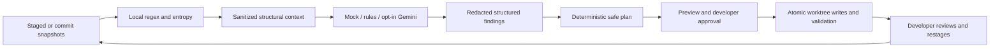

# CodeShield-AI

A local-first CLI that detects staged credentials, verifies sanitized context, and
helps developers replace hardcoded values with environment references safely.
Built for Python and server-side Node.js workflows. **Mock verification is the
default. No frontend, hosted service, or automatic credential transmission.**

Detect -> verify -> plan -> preview -> approve -> validate -> intentionally restage.
AI advice never authorizes edits; deterministic checks and developer approval do.

## Install

Requires Python 3.12+ and Git. Local validation uses Windows/Python 3.14; CI is
configured for Windows/Linux and Python 3.12/3.14. See the actual verification
record in [release readiness](docs/release-readiness.md) before relying on a platform.

```powershell
git clone https://github.com/luzain-sara/codeshield-ai.git
cd codeshield-ai
python -m venv .venv
.\.venv\Scripts\python.exe -m pip install --require-hashes --only-binary=:all: -r requirements.lock
.\.venv\Scripts\python.exe -m pip install --no-build-isolation --no-deps .
.\.venv\Scripts\codeshield.exe --help
.\.venv\Scripts\codeshield.exe doctor
```

On Linux/macOS use `.venv/bin/python` and `.venv/bin/codeshield`. After activating
the environment, use the short commands below. Run them at your target repository
root. The base lock has no Gemini SDK. For development or optional SDK tests,
install `requirements-dev.lock` instead, then install the project with
`--no-build-isolation --no-deps -e .`. `pip install -e .` also works, but does not
lock transitive dependencies. Nothing installs a hook automatically.

## Reproducible offline demo

```powershell
.\.venv\Scripts\python.exe scripts/demo.py
.\.venv\Scripts\python.exe scripts/demo.py --approve-demo-fix
```

The first command detects a synthetic staged credential, verifies with mock,
explains it, and displays a redacted patch. The second explicitly approves the
fix **only in a disposable temporary repository**. It proves the worktree is
fixed while the index still blocks, intentionally restages, and verifies exit 0.
Both clean up automatically, make no commits/pushes and consume no Gemini quota.
The [sample fixture](examples/demo-repo/README.md) cannot authenticate to a service.
Its fixture marker is removed only in the disposable copy. Application code is
syntax-checked, never executed. No actual value is written to `.env` by the demo.

## Everyday commands

```sh
codeshield init                         # create missing public defaults; preserve existing files
codeshield doctor                       # setup/ignore checks, not a security audit
codeshield scan --staged                 # default: immutable staged additions only
codeshield scan --path .                 # explicitly inspect working-tree sources
codeshield scan --format json --output report.json
codeshield explain FINDING_ID
codeshield fix FINDING_ID --dry-run
codeshield fix FINDING_ID --apply         # interactive approval required
# Review the worktree edits, then deliberately restage:
git add path/to/modified-file .gitignore .env.example
codeshield scan --staged
```

Use a finding ID from the latest scan. `explain` and `fix` reconstruct it across
processes; raw matches are not persisted. `--apply --yes` is explicit approval for
trusted local automation. `--store-secret` additionally approves a private,
ignored `.env` update; the default adds only a blank `.env.example` placeholder.
The application must load its environment separately. Source or metadata changes
invalidate the plan. Existing output files are never overwritten. `init` does not
repair an existing `.gitignore`; review its guidance and run `doctor`. If init is
interrupted, inspect any partially created defaults before retrying.

| Exit | Meaning |
| --- | --- |
| 0 | Completed successfully; selected scan has no blocking findings, or approval declined |
| 1 | Blocking findings; also returned after a fix while the index requires restaging |
| 2 | Invalid arguments/configuration, missing live consent or credentials |
| 3 | Scan, history, validation, report or provider failure; fail closed |

A gate must reject every nonzero result. Exit 0 never proves a repository secure.

## Human terminal output

Human scans use Rich for a compact CodeShield-AI header, summary, numbered finding
panels, and a final security-gate result. Panels show severity, location, rule,
confidence, actual verification source/status, finding ID, redacted evidence,
explanation and a next action. Mock assessments are explicitly labeled `mock`.
No original source, secret values, model requests or private plans are rendered.

```sh
codeshield scan --staged
codeshield scan --staged --no-color
codeshield --no-color scan --path .
codeshield scan --format json --output report.json
codeshield fix FINDING_ID --dry-run --no-color
```

Example human report excerpts (invented metadata; panels omitted here):

```text
CodeShield-AI
Scope: staged  |  provider: mock
Files scanned:     2
Skipped files:     0
Total findings:    1
Blocking findings: 1

Finding 1 | HIGH
Location:     src/service.py:7:4
Rule:         secret-assignment
Confidence:   85%
Source:       mock
Verification: ok | likely_secret | cached=false
Finding ID:   aaaaaaaaaaaaaaaaaaaaaaaa
Evidence: <REDACTED_SECRET>

Security gate: BLOCKED
```

`PASS` means a completed scan found no blocking findings in the selected scope;
`BLOCKED` means blocking findings remain; `ERROR` means scanning, configuration,
report creation or verification could not complete. Existing exit codes still
apply. A preview or declined approval never claims a clean security gate; applied
fixes stay `BLOCKED` until intentional restaging and a fresh scan.

Colors are automatic only on terminals; `--no-color`, `NO_COLOR` (even empty),
`CLICOLOR=0`, and `TERM=dumb` disable colors. Pipes and saved human reports use
plain ASCII borders without ANSI codes. Terminal width is capped at 96 columns;
long metadata wraps. Unsupported Unicode characters are escaped on legacy stream
encodings. No status depends on color alone. JSON output is byte-compatible with
the existing serializer, never imports Rich, and contains no banners or panels.
`explain` retains its existing sanitized JSON output. For automation, prefer JSON
and exit codes over parsing human text. Docker scans also accept `--no-color`.

## Git hooks, pull requests and Docker

```sh
codeshield hook install
codeshield hook uninstall
codeshield scan --base-ref BASE --head-ref HEAD --format json
codeshield scan --base-ref BASE --head-ref HEAD --merge-base --format json
```

Hooks scan the whole staged diff without modifying files. Existing custom/shared
hooks are preserved. The pre-commit framework manifest is also provided. Hooks
can be bypassed; configure a required CI check separately. PR checks use the
unique merge base of event SHAs; push checks compare before/after commits. Missing
history fails closed, with no index fallback. A new branch uses an empty base.
CI uploads only a redacted JSON report and never applies fixes.

```sh
docker build -t codeshield .
docker run --rm --network=none --mount "type=bind,src=$PWD,dst=/repo,readonly" codeshield --staged --format json
```

In PowerShell use `src=$($PWD.Path)`. Docker uses a digest-pinned base, hash-locked
wheels, a non-root scan-only entry point, and allowlisted build inputs. Hooks, CI,
and Docker interfaces force offline verification. See [integration setup and
limits](docs/integrations.md), including mount permissions and unverified checks.

## Optional Gemini

Install the development lock, configure `GEMINI_API_KEY` securely in the environment
or an ignored `.env`, then explicitly select:

```sh
codeshield scan --staged --provider gemini --allow-live
```

Both flags are required; abbreviated options are rejected. No default command,
hook, test, CI job or image build makes a live call. The model receives a finite
sanitized schema: original values, names, paths, comments and unrelated literals
are removed. Responses use strict enums, cannot execute tools or authorize fixes,
and cannot remove blocking findings. Missing keys and API failures fail closed.
Safe cached results, shared call budgets, bounded retries/backoff and deadlines
limit quota use. Tests intercept the SDK transport; live connectivity, model
availability, billing and account quotas are not automatically verified.
See [configuration and verification](docs/verification.md) for exact controls.

## Architecture



`git_diff.py` bounds Git reads; `detectors/` handles literal/prefix/entropy rules;
`agent/` owns sanitization, allowlisted read-only tools, strict decisions and safe
cache; `remediation/` proves supported transformations and handles permissions,
atomic replacement, validation and rollback. The index remains unchanged during
remediation. [Architecture](docs/architecture.md) and [remediation policy](docs/remediation.md)
describe the trust boundaries and supported Python/server-side Node.js subset.

## Validation and release status

```sh
python -m pytest -q
python -m compileall -q codeshield scripts
python -m pip check
python scripts/check_install.py
# Where Docker is available:
python scripts/check_docker.py codeshield
```

Tests cover full CLI journeys, mock/intercepted SDK verification, missing keys,
rate limits, malformed responses, redaction, safe/refused fixes, approval,
rollback/retry, staged snapshots, Git hooks, Git refs and CI configuration.
`check_install.py` builds and inspects wheel/sdist contents and verifies a fresh
hash-locked installation outside the checkout. It downloads public dependencies,
not model data. [Release readiness](docs/release-readiness.md) records actual
results and remaining external checks. No tag, release, commit or push is created
by this work. See [changelog](CHANGELOG.md), [contributing](CONTRIBUTING.md),
[security policy](SECURITY.md) and [MIT license](LICENSE).

## Limits

Detection is heuristic: split/encoded/dynamic credentials and unfamiliar formats
may be missed. Comments/fixture markers, configured excludes, binaries, generated,
vendor and unsupported files reduce coverage; review reported skips. Ref scans
check added lines between snapshots, not every intermediate commit or full history.
Only supported unambiguous Python/server-side Node literals can be fixed. Browser
bundles, public environment prefixes, unsupported frameworks and ambiguous edits
are refused. Syntax checks do not prove runtime behavior. Real credential rotation
is always your responsibility. Handled failures roll back; power loss, forced
termination and hostile concurrent writes can require manual recovery. No scanner,
model assessment or refactor provides a security guarantee.
