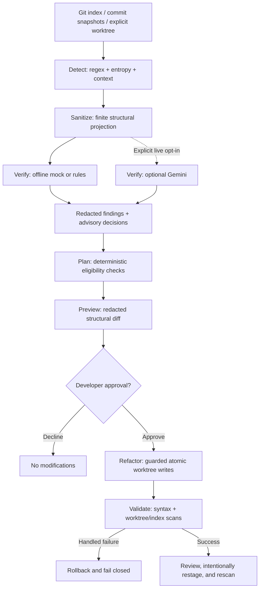

# CodeShield-AI

**A developer-first, AI-assisted security agent for potential hardcoded secrets—with redacted verification and approval-gated remediation.**

[](pyproject.toml)
[](#optional-gemini-verification)
[](LICENSE)

Scan staged changes, inspect readable findings, preview a safe fix, and decide what gets changed. CodeShield-AI combines deterministic detection with a bounded verification workflow and conservative Python/server-side Node.js refactoring.

> **Offline by default.** Mock verification requires no API key. Optional Gemini receives a sanitized structural projection. AI advice cannot authorize edits or dismiss blocking findings.

[Quick start](#getting-started) · [CLI showcase](#cli-showcase) · [How it works](#how-it-works) · [Integrations](#integrations) · [Security](#security-architecture) · [Validation](#testing-and-validation)

## The problem and the approach

An API key, access token, or password committed as a literal can expose services and data. Removing it from the latest source does not revoke the credential or erase its history. Alerts also leave a second problem: making a correction without breaking code or overlooking the staged copy.

CodeShield-AI brings detection and a controlled correction workflow into the developer's Git loop. It checks staged additions before commit, produces redacted findings, and supports narrowly validated environment-variable replacements. Hooks and CI can block unresolved findings before they are merged or deployed.

**The important boundary:** a fixed working-tree file does not clear the Git index. After remediation, developers must review, deliberately restage, and scan again.

## Key features

| Capability | What is implemented |
| --- | --- |
| Deterministic detection | Credential-prefix regexes, credential-named assignments, authorization values, and context-aware Shannon entropy; configurable rules and bounded matching. |
| Accurate scan scope | Staged additions by default, explicit worktree scans, and immutable Git-ref comparisons with rename handling and snapshot checks. |
| AI-assisted verification | Offline rules/mock providers and optional official Gemini SDK integration; strict enum decisions, truthful provenance, and a bounded workflow. |
| Redacted reporting | Rich finding panels and stable JSON reports with safe metadata, finding IDs, confidence, and PASS/BLOCKED/ERROR gate results. |
| Conservative remediation | Parser-backed eligibility checks, sanitized patch previews, explicit approval, guarded atomic writes, and rollback on handled failures. |
| Validation and fail-closed gates | Syntax checks, fresh worktree/index scans, file/path/size limits, and nonzero results for scan or verification failures. |
| Developer integrations | Native Git and pre-commit framework hooks, GitHub Actions PR/push checks, and redacted CI artifacts. |
| Reproducible packaging | Exact dependency pins and wheel hashes, wheel/sdist installation checks, and a digest-pinned, non-root Docker scan interface. |

Detection covers supported Python, JavaScript/TypeScript, JSON/YAML, and dotenv-style files. **Remediation is a smaller subset**, described under [security architecture](#security-architecture).

## How it works

**Detect → Verify → Plan → Preview → Approve → Refactor → Validate**

The agent follows fixed transitions and allowlisted read-only tools. Verification supplies advisory metadata; deterministic local policy decides whether a transformation is eligible. Developer approval is required before writes.



Raw candidates remain inside the trusted local scanner/planner. No model receives the original source, a private remediation plan, or a credential value. See the [architecture notes](docs/architecture.md) for the implementation boundaries.

## CLI showcase

Commands below assume the installed virtual environment is on `PATH`; explicit executable paths are shown in [installation](#installation).

```sh
codeshield scan --staged
codeshield scan --staged --no-color
codeshield scan --path .
codeshield scan --staged --format json --output report.json
```

Human scans show a compact header, scan summary, numbered finding panels, redacted evidence, an explanation, and an actionable recommendation. Colors distinguish severity, while text labels keep redirected output readable.

<details>
<summary><strong>View a blocked report from the current Rich formatter</strong></summary>

Rendered with synthetic metadata at 72 columns. The ID is illustrative; use a fresh scan's ID for commands.

```text
CodeShield-AI
Scope: staged  |  provider: mock

+- Scan summary -------------------------------------------------------+
| Files scanned:     2                                                 |
| Skipped files:     0                                                 |
| Total findings:    1                                                 |
| Blocking findings: 1                                                 |
+----------------------------------------------------------------------+

+- Finding 1 | HIGH ---------------------------------------------------+
| Severity:     HIGH                                                   |
| Location:     src/service.py:7:4                                     |
| Rule:         secret-assignment                                      |
| Confidence:   85%                                                    |
| Source:       mock                                                   |
| Verification: ok | likely_secret | cached=false                      |
| Finding ID:   aaaaaaaaaaaaaaaaaaaaaaaa                               |
|                                                                      |
| Evidence: <REDACTED_SECRET>                                          |
| Detection: Credential-named literal assignment                       |
| Explanation: A credential-like literal was detected. Verification is |
| advisory and cannot authorize a fix.                                 |
| Next: Remove the hardcoded value. Rotate it if exposed; review and   |
| rescan staged changes.                                               |
+----------------------------------------------------------------------+

+----------------------------------------------------------------------+
| Security gate: BLOCKED                                               |
| Blocking findings remain. Review locally, remediate safely, and      |
| rescan staged changes.                                               |
+----------------------------------------------------------------------+
Only the selected scope and supported files were checked; this is not a
security guarantee.
```

</details>

For an eligible staged finding, replace `FINDING_ID` with the current scan's 24-character ID:

```sh
codeshield explain FINDING_ID
codeshield fix FINDING_ID --dry-run
codeshield fix FINDING_ID --apply
```

`explain` reconstructs sanitized JSON metadata. `fix --dry-run` shows a Rich remediation preview; `--apply` requests interactive approval. Trusted local automation can explicitly use `--apply --yes`. Choosing an environment name is supported through `--env-name SERVICE_API_KEY`.

An applied fix reports `fix_applied_to_worktree_requires_restage` and exits **1**. Review the edits, stage the intended files yourself, and rerun `codeshield scan --staged`. A preview or declined approval never claims that the index is clean.

| Scan gate / exit | Meaning |
| --- | --- |
| PASS / `0` | A completed scan has no findings at or above the configured blocking severity. |
| BLOCKED / `1` | Blocking findings remain; also returned after apply while restaging is required. |
| ERROR / `2` | Invocation/configuration error, missing live consent, or invalid/missing credentials. |
| ERROR / `3` | Scan, history, report, validation, or provider failure; fail closed. |

Other successful operations, previews, and declined approvals also return `0`; that is not a security verdict. Gates must reject every nonzero result. CLI usage errors may use a plain diagnostic rather than a scan panel.

Colors are terminal-aware. `--no-color`, `NO_COLOR` (including an empty value), `CLICOLOR=0`, and `TERM=dumb` disable colors. Redirected output and saved human reports contain no ANSI styles. Layout width is capped at 96 columns, long metadata wraps, and unsupported Unicode is escaped on legacy encodings. JSON serialization bypasses Rich and remains suitable for automation; output files must be new and are never overwritten.

## Getting started

### Prerequisites

| Requirement | Purpose |
| --- | --- |
| Python 3.12+ | CLI runtime; Python 3.14 is included in the CI matrix. |
| Git | Snapshot scanning, hooks, and the disposable demo. |
| Node.js on `PATH` | Required for server-side JavaScript remediation validation; detection does not require Node. |
| Docker, optional | Run the packaged scan-only CLI. |

### Installation

```sh
git clone https://github.com/luzain-sara/codeshield-ai.git
cd codeshield-ai
```

<details>
<summary><strong>Windows PowerShell</strong></summary>

Use explicit virtual-environment executables; activation-policy changes are unnecessary.

```powershell
python -m venv .venv
.\.venv\Scripts\python.exe -m pip install --require-hashes --only-binary=:all: -r requirements.lock
.\.venv\Scripts\python.exe -m pip install --no-build-isolation --no-deps .
.\.venv\Scripts\codeshield.exe --help
.\.venv\Scripts\codeshield.exe doctor
```

</details>

<details>
<summary><strong>Linux</strong></summary>

```sh
python3 -m venv .venv
.venv/bin/python -m pip install --require-hashes --only-binary=:all: -r requirements.lock
.venv/bin/python -m pip install --no-build-isolation --no-deps .
.venv/bin/codeshield --help
.venv/bin/codeshield doctor
```

</details>

The base lock installs no Gemini SDK. Use `requirements-dev.lock` instead for tests and optional SDK tests, followed by an editable install with `--no-build-isolation --no-deps -e .`. Direct `pip install -e .` is supported but does not lock transitive dependencies. Nothing installs a Git hook automatically.

### Configuration

Run commands from the target repository root. `codeshield init` creates missing public defaults without overwriting existing files or creating `.env`. `codeshield doctor` checks setup and dotenv ignore/tracking safety; it does not scan for secrets or certify commit safety.

A minimal `codeshield.toml` can contain:

```toml
provider = "mock"
blocking_severity = "high"
max_api_calls = 5
api_max_retries = 2
verification_cache_ttl_seconds = 86400
```

Inspect [the supplied configuration](codeshield.toml) for all settings. Explicit configuration is supported with `codeshield scan --config codeshield.toml --staged`. Unknown/invalid settings fail validation. Keep keys out of TOML and source control. Existing ignore rules are preserved by initialization, so review its guidance and run `doctor`.

### Quick-start demo: synthetic credentials only

From the checkout, run locally outside CI:

```powershell
.\.venv\Scripts\python.exe scripts/demo.py
.\.venv\Scripts\python.exe scripts/demo.py --approve-demo-fix
```

On Linux, replace the interpreter path with `.venv/bin/python`.

1. The first command stages an invented credential in a disposable repository, detects it, verifies with mock, explains the finding, and previews a redacted fix.
2. The second explicitly approves a fix in a new disposable repository, validates the worktree, confirms the original index still blocks, intentionally restages the demo files, and verifies the clean staged scan.

Both commands clean up automatically, make no commits or pushes, and consume no Gemini quota. The demo does not store a value in `.env` or execute the example application. Its [fixture source](examples/demo-repo/README.md) has a reviewed marker that is removed only in the disposable copy.

## Integrations

### Git pre-commit hooks

```sh
codeshield hook install
codeshield hook uninstall
```

The native hook scans staged additions and blocks on any nonzero scanner result. It records the current interpreter path, preserves existing custom hooks, and refuses unsafe/shared hook paths. Keep the installing environment available. Git for Windows supplies the hook shell.

The repository also includes [a pre-commit framework manifest](.pre-commit-hooks.yaml). Hooks always use mock verification and never apply fixes. Hooks can be bypassed; require CI checks separately. See [integration guidance](docs/integrations.md) for composition, worktrees, and installation details.

### GitHub Actions and Git-ref scanning

| Workflow | Responsibility |
| --- | --- |
| [CodeShield security gate](.github/workflows/codeshield.yml) | PR merge-base and push before/after comparisons, redacted JSON artifact upload, and a blocking outcome. |
| [Tests and Docker checks](.github/workflows/tests.yml) | Windows/Linux × Python 3.12/3.14 tests, compilation, fresh installation checks, plus a Docker smoke-test job. |

Workflows use pinned actions and read-only repository permissions. The security job checks out full history, does not persist checkout credentials, forces mock verification, and never applies remediation.

```sh
codeshield scan --base-ref BASE --head-ref HEAD --format json
codeshield scan --base-ref BASE --head-ref HEAD --merge-base --format json
codeshield scan --base-ref EMPTY --head-ref HEAD --format json
```

Replace `BASE`/`HEAD` with available commits or refs. Endpoint comparison is the default; `--merge-base` uses the unique merge base for PR semantics. `EMPTY` checks the supported files in the head tree for a new branch. Missing, shallow, or ambiguous history fails closed, with no index fallback. Deleted-branch push events are skipped. Ref scans inspect snapshot additions, not every intermediate commit.

### Docker

```sh
docker build -t codeshield .
docker run --rm --network=none --mount "type=bind,src=$PWD,dst=/repo,readonly" codeshield --staged --format json
```

For PowerShell, use `src=$($PWD.Path)` in the mount string. The image uses a digest-pinned Python base, hash-verified wheels, allowlisted build inputs, UID 10001, and a scan-only entry point. The mounted repository and Git objects must be readable by that user. Live Gemini and fix commands are unavailable through the container interface; human scans accept `--no-color`. Read-only scans can write reports to stdout; file output requires a separate writable destination.

## Security architecture

| Boundary | Enforcement |
| --- | --- |
| Secret handling | Candidates stay in trusted local memory. Human/JSON findings, previews, caches, and model payloads omit raw credential values. |
| External verification | A finite projection removes original values, source literals, identifiers, comments, and paths. Strict enum responses are advisory; even a false-positive assessment cannot remove blocking findings. |
| Remediation authority | Offline deterministic planning proves eligible literals with Python AST or Tree-sitter. Plans are revalidated after explicit approval; source/index/metadata changes invalidate them. |
| Filesystem writes | Containment/link checks, guarded snapshots, private temporaries, atomic file replacement, and rollback on handled failures. |
| Secret storage | Default fixes add blank `.env.example` placeholders. `--store-secret` separately consents to an ignored, untracked, permission-restricted `.env` update. Existing destination keys are not overwritten. |
| Post-fix safety | Syntax validation never executes application code. Working-tree and staged scans are checked; remediation does not stage, commit, push, or rotate credentials. |

**Eligible remediation:** simple single-line Python module-level string assignments and eligible server-side JavaScript top-level declarations in `.js`, `.cjs`, or `.mjs`. Node eligibility requires server startup/dependency evidence; an engine version alone is insufficient. The application must load its environment separately.

**Refused cases:** client/browser exposure, `VITE_*`/`NEXT_PUBLIC_*` destinations, unsupported frameworks, TypeScript/JSX/Go/config-file fixes, dynamic or ambiguous transformations, conflicting unstaged edits, and unsafe filesystem targets. See [the supported-code and refusal policy](docs/remediation.md#supported-code-and-refusals) for the exact subset.

### Optional Gemini verification

Mock is the default; `--provider rules` is also fully offline. To use Gemini, install the optional dependencies—for a pinned environment, use the development lock—and configure `GEMINI_API_KEY` securely in the environment or an ignored repository-root `.env`.

```sh
codeshield scan --staged --provider gemini --allow-live
```

Gemini must be selected through `--provider gemini` or configuration, and every live scan requires `--allow-live`. The command above makes both choices explicit. Setting a key or selecting Gemini in TOML alone does not authorize a request. Environment credentials take precedence over `.env`; credentials are not printed or interpolated.

Safe cached decisions, a shared call budget, bounded retries/backoff, and deadlines limit unnecessary requests. Missing keys and API failures fail closed. Mock/rules do not create a verification cache. Tests intercept SDK HTTP transport, and automated hooks/CI/container interfaces cannot enable live verification. Live availability, billing, and account quotas are not automatically tested. [Verification details](docs/verification.md) document the exact controls.

## Testing and validation

Tests exercise staged/ref/worktree semantics, false positives, redaction, malformed/provider-failure responses, missing keys, rate limits, caching and budgets, safe/refused remediation, approval, rollback/retry, restaging, native hooks, CI event handling, packaging, and Rich/JSON compatibility.

Most recent full-suite **local results for the current Rich CLI implementation**, verified before this README-only update:

| Environment | Verified result |
| --- | --- |
| Windows, Python 3.14.0 | **460 passed, 1 skipped** |
| Ubuntu 24.04 WSL, Python 3.12.3 | **461 passed** |

The Windows skip is unavailable filesystem-symlink creation; portable Git-index link tests passed. Fresh wheel/sdist installation and local push/PR security comparisons also passed. These are test results, not performance benchmarks or evidence that every platform is verified.

The configured hosted matrix is `ubuntu-24.04` and `windows-2025`, each on Python 3.12 and 3.14. Its latest remote status, the current Docker build, macOS, and every terminal emulator were not independently verified in this documentation pass. Earlier phase validation history is available in [release readiness](docs/release-readiness.md).

To reproduce checks in an activated development environment:

```sh
python -m pip install --require-hashes --only-binary=:all: -r requirements-dev.lock
python -m pip install --no-build-isolation --no-deps -e .
python -m pytest -q
python -m compileall -q codeshield scripts
python -m pip check
python scripts/check_install.py
# After building the image, where Docker is available:
python scripts/check_docker.py codeshield
```

`check_install.py` builds and inspects a clean source copy with synthetic exclusion canaries, then verifies a fresh installed CLI without the Gemini SDK. Dependency/build downloads need network access; tests use mock/intercepted providers and make no live Gemini calls.

## Tech stack

| Area | Technologies present |
| --- | --- |
| CLI and presentation | Python 3.12+, standard-library `argparse`, Rich |
| Contracts and configuration | Pydantic, TOML/`tomllib` |
| Detection and source handling | `regex`, Shannon entropy, Python AST, Tree-sitter + JavaScript grammar |
| Optional model provider | Official `google-genai` SDK, `python-dotenv` |
| Developer tooling | Git subprocesses, GitHub Actions, Docker |
| Testing and packaging | pytest, PyYAML for configuration tests, setuptools, pip, hash-locked dependencies |

## Project structure

```text
codeshield/
  cli.py, arguments.py, initialization.py   Commands and public defaults
  scanner.py, git_diff.py                   Bounded snapshot selection and scanning
  reporting.py, terminal.py, models.py      JSON, Rich output, and validated contracts
  detectors/                               Patterns, context filtering, entropy
  agent/                                   Sanitization, providers, tools, policy, cache
  remediation/                             Eligibility, plans, guarded writes, validation
tests/
  unit/                                    Detection, contracts, formatting, packaging
  integration/                             CLI, Git, SDK transport, end-to-end safety
scripts/                                   Synthetic demo and install/container checks
examples/demo-repo/                         Invented credential fixture
docs/                                      Architecture, verification, remediation, integrations
.github/workflows/                         Security gate and test/build checks
pyproject.toml, requirements*.lock          Package metadata and pinned dependencies
Dockerfile, .pre-commit-hooks.yaml          Container and hook packaging
```

## Known limitations and future improvements

Detection is heuristic. Split, encoded, dynamically assembled, or unfamiliar credentials may be missed. Comments/fixture markers, configured exclusions, binaries, generated/vendor code, and unsupported files reduce coverage; review reported skips. Explicit fixture annotations are reviewed line-level exceptions, not a global exemption for tests.

AI verification is deliberately lossy and may be uncertain or incorrect. Syntax checks cannot prove runtime or deployment correctness. Handled failures attempt rollback, but power loss, forced termination, or hostile concurrent writes can require manual recovery. Ref scans do not audit all Git history. **Rotate/revoke any credential already exposed; moving it into an environment variable does not invalidate it.** No scan or refactor guarantees security.

Future work, **not currently implemented**, includes broader parser-backed remediation, better server/client boundary evidence, more precise false-positive handling, and expanded macOS/terminal validation. See [SECURITY.md](SECURITY.md) for trust boundaries and safe vulnerability reporting.

## License and attribution

Created by [Luzain Sara](https://github.com/luzain-sara). Released under the [MIT License](LICENSE); copyright © 2026 Luzain Sara.

For development guidelines and change history, see [CONTRIBUTING.md](CONTRIBUTING.md) and [CHANGELOG.md](CHANGELOG.md).
